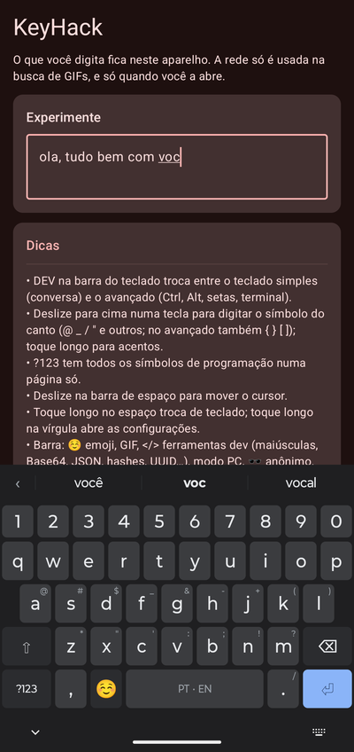
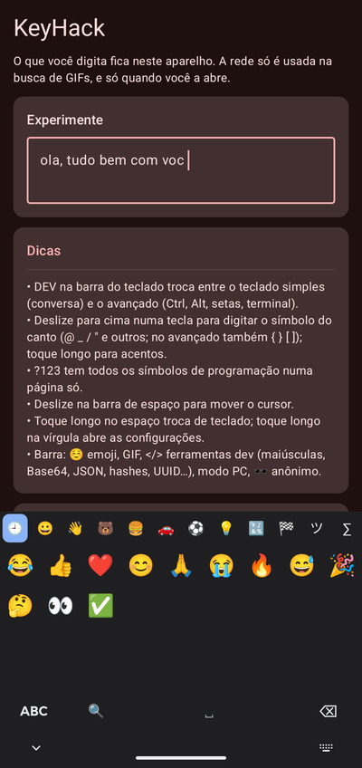
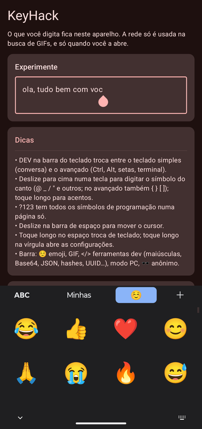
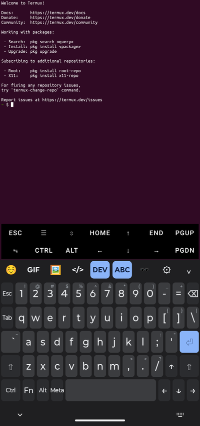
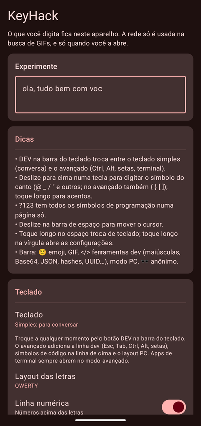

# KeyHack

An open source, privacy-first Android keyboard for power users, written in Kotlin.

"Hack" means hacker culture, the tradition of keyboards like Hacker's Keyboard
that give you a full PC layout for terminals, SSH, Vim and code. It does not
mean intrusion. KeyHack combines that with what people expect from a modern
phone keyboard: suggestions, autocorrect, emoji and GIFs.

Every keyboard can read everything you type, so KeyHack is built to be
**verifiably trustworthy**: no analytics, no crash reporting, no telemetry,
learning that stores word counts only, and a single, auditable network use
(GIF search).

> **Status: 0.1.0, first public preview.** See the [changelog](CHANGELOG.md)
> and the [roadmap](#roadmap).

<p>
  
  
  
  
  
</p>

## Download

Get the APK from the **[releases page](https://github.com/reinanbr/keyhack/releases)**
([latest version](https://github.com/reinanbr/keyhack/releases/latest)). Each
release lists its changes and a `SHA256SUMS` file. Android 9 or newer.

1. Download `KeyHack-<version>.apk` and open it (allow installing from your
   browser or file manager when Android asks).
2. Open KeyHack and follow the two setup steps: enable it, then choose it.

Check the download before installing:

```sh
sha256sum -c SHA256SUMS
apksigner verify --print-certs KeyHack-<version>.apk
```

Every commit to `main` also produces a debug APK under the CI run's
artifacts. It is signed with a throwaway key, so it cannot update a release
install; use it only for testing.

## Features

- **Hacker's Keyboard side:** optional number row and a configurable dev row
  (Esc, Tab, Ctrl, Alt, arrows, Home, End); a full 5-row PC layout with an Fn
  layer (F1–F12, PgUp/PgDn, Ins, Del, PrtSc); sticky Ctrl/Alt/Meta (tap once
  for the next key, twice to lock) sent as real key events, so Ctrl+C works in
  Termux; PC mode switches on automatically in terminal and SSH apps.
- **Gboard side:** long-press accents and symbols, space-bar cursor trackpad,
  QWERTY, ABNT2, AZERTY, Dvorak and Colemak layouts (JSON, documented in
  [`layouts/README.md`](layouts/README.md)); English and Brazilian Portuguese
  dictionaries with autocorrect (undo with backspace), completions and
  next-word prediction; emoji with categories, recents, skin tones and
  EN/PT search; kaomoji; GIF search (results update as you type) with your own Giphy API key;
  stickers: import your images (GIFs become animated stickers) or send any
  emoji as a WhatsApp sticker.
- **Dev tools:** case conversions (camelCase, snake_case…), Base64, URL and
  HTML escaping, JSON pretty/minify, MD5/SHA hashes, UUID v4/v7, timestamps.
- **Privacy controls:** incognito mode; nothing learned or suggested in
  password fields or fields that ask for no personalized learning.

## Security boundary: one app, one network use

KeyHack (`com.reinanbr.keyhack`) holds two permissions: `VIBRATE` (haptics)
and `INTERNET`, used **only** for GIF search ([ADR 0004](docs/adr/0004-single-app-gif-network.md)):

- all network code lives in the `:media` module; a detekt rule rejects network
  imports everywhere else, so one small module covers every request;
- requests are made only while the GIF panel is open, only with the API key
  you entered, and carry only the GIF search text (never the field you are
  typing in); no GIF button in incognito or password fields;
- HTTPS only, system CAs only, provider host allowlist re-checked on redirects;
- turning GIFs off in settings means the app never touches the network.

Every build checks the **merged** release manifest, with all library manifests
included, and fails if any other permission appears or a component is exported
outside a fixed allowlist ([ADR 0002](docs/adr/0002-core-permission-and-export-policy.md)).

Check a release APK yourself:

```sh
aapt2 dump permissions app-release.apk
```

## Threat model

**Assets:** everything you type (passwords included), clipboard contents,
learned vocabulary, your sticker library, the GIF provider API key.

The GIF provider (Giphy) sees your GIF search terms, your API key and
your IP address.

| # | Adversary or risk | Main mitigations |
|---|---|---|
| 1 | The keyboard itself as a keylogger | Network code confined to `:media` by a build rule, GIF search only; learning stores word/pair counts only, never sentences; no logging of typed text |
| 2 | Malicious apps on the device | Minimal exported components (allowlisted at build time); non-exported FileProvider for GIFs; read-only, traversal-safe sticker provider |
| 3 | Malicious files (layouts, themes, snippets, dictionaries, media) | Size caps, magic-byte MIME sniffing, strict schemas, copy-then-process, memory-safe decoders, fuzzed parsers |
| 4 | Network attackers | HTTPS only, no cleartext, no user CAs, provider host allowlist; responses size-capped and parsed as untrusted |
| 5 | Compromised dependencies or CI | Gradle dependency verification (checksums + PGP), SHA-pinned Actions, least-privilege workflows, reproducible builds, SBOM |
| 6 | Accidental leakage | No cloud backup or device transfer; release builds strip `android.util.Log`; opt-in, encrypted, expiring clipboard history; no learning in sensitive fields |

**Sensitive fields** (password input types, `TYPE_TEXT_FLAG_NO_SUGGESTIONS`,
`IME_FLAG_NO_PERSONALIZED_LEARNING`, or incognito) get no suggestions, no
autocorrect, no learning, no clipboard capture and no snippet expansion
(from M1 onwards).

## Architecture

```
:app          settings app, onboarding, IME activation flow
:ime          InputMethodService, InputConnection, field policy, panels
:keyboard     layout model and parser, Canvas rendering, touch, accessibility
:layouts      bundled JSON layouts (see layouts/README.md)
:suggest      dictionaries, autocorrect, prediction, count-only learning
:emoji        emoji data, search, skin tones, kaomoji
:media        GIF providers and the app's only HTTP client
:commit       commitContent and fallbacks
:devtools     text transforms (case, Base64, JSON, hashes, UUID, time)
:stickers     sticker library and converters                     (M5)
:clipboard    opt-in encrypted history                           (M4)
:security     Keystore crypto, validators, MIME                  (M1+)
:data         settings
:theme        themes, Material You
:core         shared utilities (JSON)
tools/        generators for the dictionary and emoji assets
build-logic/  convention plugins and the manifest policy gate
```

The key grid is a custom `View` drawn on a `Canvas` (no allocation in
`onDraw`); panels and settings use Jetpack Compose. Each key is exposed to
TalkBack as a virtual view.

## Building

Requirements: JDK 21 and the Android SDK (platform 37).

```sh
./gradlew assembleDebug                 # debug APK
./gradlew check                         # unit tests, lint, detekt/ktlint, manifest gate
./gradlew assembleRelease               # R8-minified, unsigned unless signing env is set
./gradlew detekt -PdetektAutoCorrect    # apply formatting fixes
```

Release signing reads `KEYHACK_KEYSTORE`, `KEYHACK_KEYSTORE_PASSWORD`,
`KEYHACK_KEY_ALIAS` and `KEYHACK_KEY_PASSWORD` from the environment (CI
secrets). Keys never live in the repository.

### Releasing

1. Bump `versionCode` and `versionName` in `app/build.gradle.kts`.
2. Move the `Unreleased` notes in [CHANGELOG.md](CHANGELOG.md) to a new
   version section.
3. Commit, tag and push: `git tag -a v0.2.0 -m "KeyHack 0.2.0" && git push origin main v0.2.0`.

The [release workflow](.github/workflows/release.yml) checks that the tag
matches `versionName`, runs every check, signs the APK with the key from the
repository secrets (`KEYHACK_KEYSTORE_BASE64`, `KEYHACK_KEYSTORE_PASSWORD`,
`KEYHACK_KEY_ALIAS`, `KEYHACK_KEY_PASSWORD`) and publishes it with the
changelog section as release notes.

After changing dependencies, regenerate the verification metadata and review
the diff:

```sh
./gradlew --write-verification-metadata pgp,sha256 --export-keys check assembleRelease
```

## Roadmap

| | Milestone | Status |
|---|---|---|
| M0 | Skeleton, CI, dependency verification, permission gate, backup off, log stripping, basic QWERTY IME | ✅ |
| M1 | JSON layouts, long-press, symbols, themes, settings, sensitive-field policy | ✅ |
| M2 | PC mode: full layout, sticky modifiers, dev row, per-app PC mode | ✅ |
| M3 | Dictionaries, autocorrect, prediction, count-only learning, incognito | ✅ |
| M4 | Emoji ✅, opt-in encrypted clipboard history | partial |
| M5 | Stickers: import ✅, emoji stickers ✅, GIF→animated WebP ✅, commitContent to WhatsApp ✅; WhatsApp sticker packs | partial |
| M6 | GIF search (Giphy, BYOK; Tenor's API closed 2026-06-30), commitContent | ✅ |
| M7 | Dev tools: trackpad ✅, transforms ✅, snippets, command palette | partial |
| M8 | Glide typing | |
| M9 | Floating/one-handed modes, theme editor, backup export, `offline` flavor without network, F-Droid | |

## Contributing and security

See [CONTRIBUTING.md](CONTRIBUTING.md). Report vulnerabilities privately as
described in [SECURITY.md](SECURITY.md), never in public issues.

## License

[Apache License 2.0](LICENSE). Third-party origins are listed in [NOTICE](NOTICE).
